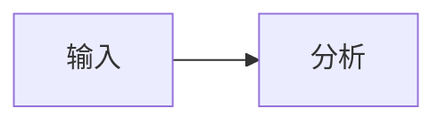

# slidev-theme-hebmu

A [Slidev](https://sli.dev) presentation theme for **河北医科大学 (Hebei Medical University)** academic teaching — Chinese-first typography with bilingual (中/EN) support.

## Features

- Chinese-first typography (PingFang SC, CJK-optimized spacing)
- Bilingual layout support (Chinese title + English subtitle)
- Session-based structure (学时): 40min + 10min break + 40min
- Light-first classroom presentation design
- Bioinformatics-optimized: Mermaid diagram theming, code highlighting
- Compact density option for table/code-heavy teaching slides
- UnoCSS utility escape hatch (`setup/unocss.ts`) for custom one-off slides — grids, flex, etc.

## Quick Start

### In your Slidev project

Add the theme as a local dependency in your `package.json`:

```json
{
  "dependencies": {
    "slidev-theme-hebmu": "file:path/to/slidev-theme-hebmu"
  }
}
```

Then set it in your slide frontmatter:

```markdown
---
theme: hebmu
fonts:
  sans: 'PingFang SC'
  mono: 'Fira Code'
htmlAttrs:
  lang: zh-CN
---
```

## Layouts

| Layout | Description | Key Props |
|---|---|---|
| `cover` | Title slide with university branding | `coverAuthor`, `coverDate`, `courseName`, `sessionNumber` |
| `section` | Section divider (第X节) | `sectionNumber`, `sectionTitle`, `sectionTitleEn` |
| `default` | Standard content slide (also covers centered / two-column / quote via UnoCSS utilities) | — |
| `figure` | Figure with caption; side-by-side text via `figureX` | `figureUrl`, `figureCaption`, `figureX` |
| `table-of-contents` | Keynote-style agenda/content slide | `contentItems`, `active`, `contentImageUrl` |
| `break` | Break divider (10 min) | `breakMinutes` |
| `end` | Thank you / Q&A | `endMessage`, `endMessageEn` |

`default` plus a few utility classes replaces the former `center` / `two-col` /
`quote` layouts — e.g. a two-column slide is now `layout: default` with
`<div class="grid grid-cols-2 gap-7">…</div>`. The former `figure-side` layout
is now `figure` with the `figureX` prop.

## Components

| Component | Description |
|---|---|
| `<Pagination>` | Current slide number |
| `<FigureWithOptionalCaption>` | Reusable figure rendering |
| `<SlideTitle>` | Internal shared slide title renderer |
| `<KeynoteChrome>` / `<KeynoteShell>` | Internal theme chrome and layout shell |

## ThemeConfig

Set in the first slide's frontmatter:

```yaml
themeConfig:
  paginationX: 'r'     # 'l' or 'r'
  paginationY: 'b'     # 't' or 'b'
  paginationPagesDisabled: [1]  # Pages without pagination
  footerMode: 'compact'          # 'compact' or 'none'
  contentItems:                 # optional default items for table-of-contents
    - 生物信息学及工具
    - 药物发现：从0到1的数字旅程
    - CADD实战：从靶点到候选药物
```

Use compact density on content-heavy slides:

```markdown
---
layout: default
density: compact
---
```

Standard framed layouts (`default` and `figure`) use a shared
`SlideTitle`. Existing slides can keep `# Slide Title`; the first H1 is promoted
into the chrome title.
For new slides that need in-frame section headings, use `slideTitle` in
frontmatter and keep H1 for smaller content headers:

```markdown
---
layout: default
slideTitle: PPI 分析流程
---

# 输入数据

- 表达矩阵
- 候选基因列表
```

Mermaid diagrams use the theme's `setup/mermaid.ts` defaults. For dense
diagrams, prefer Slidev's built-in scale option on the code fence:

````markdown

````

`footerMode: compact` shows department + page number on regular slides. Use
`footerMode: none` to hide the global footer. Contact details (author, email,
WeChat) live on the `end` layout's closing slide, configurable via the
`footerAuthor` / `footerEmail` / `footerWechat` / `footerTel` themeConfig keys.

Use the Keynote-style content slide with per-slide frontmatter:

```markdown
---
layout: table-of-contents
active: 2
contentItems:
  - 生物信息学及工具
  - 药物发现：从0到1的数字旅程
  - CADD实战：从靶点到候选药物
---
```

## Migration from 0.1.x → 0.2.0

0.2.0 is a **breaking change**. Five layouts were removed in favor of `default` + UnoCSS utilities (from the theme's `setup/unocss.ts` escape hatch) and a unified `figure` layout. Update any deck using the old names:

| Removed | Use instead |
|---|---|
| `center` | `default` + `hideFrame: true` + a flex-centered wrapper div |
| `two-col` | `default` + a `grid grid-cols-2 gap-7` wrapper (replaces `::left::` / `::right::`) |
| `quote` | `default` + a markdown `>` blockquote (base CSS styles it) + an attribution `<p>` |
| `figure-side` | `figure` + `figureX: 'l' \| 'r'` |
| `figure-footnote` | Removed in 0.4.0 — build citations from `default` + raw markup |

The `grid` / `flex` classes are generated automatically by the theme — no consumer-side UnoCSS config is required.

> 0.4.0 also removed the `intro` layout, the `<Footnotes>` / `<Footnote>` /
> `<SessionInfo>` components, and `footerMode: 'full'` — see the CHANGELOG and
> ADR-0001.

## Development

```bash
npm install
npm run dev      # Preview with example.md
npm run build    # Build static site
npm run export   # Export to PDF
npm run screenshot  # Export PNG slides for visual checks
```

## License

MIT
