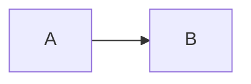

# Layout & Component Specifications

Detailed specs for all layouts and components. Referenced from CLAUDE.md via `@docs/specs.md`.

## Layouts

Each layout is a Vue SFC in `layouts/`. Auto-registered by filename (minus `.vue`). Standard content layouts use `KeynoteShell`, which wraps content in `<div class="slidev-layout keynote-layout">`, renders `KeynoteChrome`, and provides the framed `.keynote-stage`.

## ThemeConfig

| Key | Type | Default | Description |
|-----|------|---------|-------------|
| `footerMode` | `'compact' \| 'none'` | `'compact'` | Global footer behavior. Compact shows department + page number; `none` hides the footer entirely. |
| `paginationX` | `'l' \| 'r'` | `'r'` | Pagination horizontal position. |
| `paginationY` | `'t' \| 'b'` | `'b'` | Pagination vertical position. |
| `paginationPagesDisabled` | `number[]` | `[1]` | Slide numbers without pagination. Theme default hides pagination on the cover. A deck-level value replaces the theme default wholesale (no merging); pass `[]` to number every slide. |

The theme is light-first. Dark mode is not implemented in this release.

Most standard content layouts accept `density: 'normal' | 'compact'`. Use `compact` for table-heavy, code-heavy, or long-step slides.

## Mermaid

Mermaid is configured in `setup/mermaid.ts` for Slidev 51 / Mermaid 11. Soft-purple
arrows and PingFang SC by default. Optional **four-step** class hooks (opt-in):

| Class | Fill | Text |
|---|---|---|
| `:::hebmuRoot` | `--hebmu-primary` `#4e136c` | white ~20px |
| `:::hebmuPill` | `--hebmu-purple-soft` `#8f55ad` | white ~17px |
| `:::hebmuNote` | `#ebe7ef` (very light purple wash) | primary ~15px |
| `:::hebmuMuted` | `--hebmu-header-bg` `#f4f4f4` (chrome grey) | muted ~14px |
| no class | `--hebmu-bg` `#ffffff` (plain outline) | primary ~17px |

Unclassed nodes render as plain outline nodes: white fill, `--hebmu-primary-light`
border (2px), primary text. This keeps the four classed tiers distinct — `:::hebmuPill`
is not the unclassed look. Edges and arrowheads use soft purple deck-wide.

The theme does **not** lock flowchart spacing or curve; course decks override
with `%%{init}%%`, `{scale: …}`, or their own classes. It uses `theme: 'base'`,
`htmlLabels: true`, `securityLevel: 'loose'`, and `flowchart.useMaxWidth: true`
so Chinese labels, `<br/>` line breaks, and PNG/PDF export stay stable. Diagram
layout uses Mermaid's own defaults, including the `basis` curve.
`flowchart.curve` sets the path shape. It does not set where an edge meets a
node. Two edges into one node keep separate attachment points. A chart that
wants a square line path opts in inside that fence:



Dense diagrams should use Slidev's per-block scale option, for example a
Mermaid code fence with `{scale: 0.88}`.

Standard framed layouts (`default`, `figure`) render their title through the shared
`SlideTitle` component. If `slideTitle` is provided, it is used directly and H1
headings remain in the frame as smaller section headers. If `slideTitle` is not
provided, the first markdown H1 is inferred as the slide title and hidden from
the frame for backward compatibility.

Common title props:
| Prop | Type | Default | Description |
|------|------|---------|-------------|
| `slideTitle` | `string` | inferred from first H1 | Explicit chrome title |
| `hideTitle` | `boolean` | `false` on framed content layouts | Hide the chrome title |
| `autoSlideTitle` | `boolean` | `true` | Infer title from the first H1 when `slideTitle` is absent |

### cover

Title slide with university branding, course info, and author.

**Props**:
| Prop | Type | Default | Description |
|------|------|---------|-------------|
| `coverAuthor` | `string \| string[]` | `undefined` | Author name(s) |
| `coverAuthorUrl` | `string \| string[]` | `undefined` | Author link(s) |
| `coverBackgroundUrl` | `string` | `undefined` | Background image URL |
| `coverBackgroundSource` | `string` | `undefined` | Background image attribution text |
| `coverBackgroundSourceUrl` | `string` | `undefined` | Background image attribution link |
| `coverDate` | `string` | Auto | Date string |
| `courseName` | `string` | `undefined` | Course name in Chinese |
| `courseNameEn` | `string` | `undefined` | Course name in English |
| `sessionNumber` | `number` | `undefined` | 学时 number |

**Slot**: Title and subtitle content.

**Usage**:
```markdown
---
layout: cover
coverAuthor: '河北医科大学 · 生物信息学专业'
coverDate: '2026年春季学期'
courseName: '生物信息学'
sessionNumber: 18
---

# 第十章 生物分子网络分析
## Biomolecular Network Analysis
```

**Implementation notes**:
- Port from `slidev-theme-academic` `cover.vue`, adding `courseName`, `courseNameEn`, `sessionNumber` props
- Include the university logo and campus background from `themeConfig` fallbacks
- Use `resolveAssetUrl` from `layout-helper.ts` for theme asset URLs
- Supports multiple authors (array) with Chinese punctuation joining

### section

Section divider with bilingual title and section numbering (第X节).

**Props**:
| Prop | Type | Default | Description |
|------|------|---------|-------------|
| `sectionNumber` | `number` | `undefined` | Section number (renders "第X节") |
| `sectionTitle` | `string` | `undefined` | Chinese section title |
| `sectionTitleEn` | `string` | `undefined` | English section title |

**Slot**: Additional content below the title (optional).

**Usage**:
```markdown
---
layout: section
sectionNumber: 1
sectionTitle: 蛋白质-蛋白质相互作用
sectionTitleEn: Protein-Protein Interactions
---
```

**Implementation notes**:
- NEW layout — no academic equivalent.
- Large centered section number, bilingual title below
- Section titles are inline in `section.vue` (Chinese + English props). There is no separate bilingual title component.
- Thin horizontal accent line between number and title

### default

Standard content slide (~31% of slides in production).

**Props**: `density?: 'normal' | 'compact'` plus common title props. **Slot**: Full slide content.

**Implementation**: Uses `KeynoteShell` with `layoutClass="keynote-default"`.

For a one-off layout, use `default` with UnoCSS utilities (provided by `setup/unocss.ts`). A three-column slide is a one-off. A markdown `>` blockquote is a **pull quote** or short **vignette** (HEBMU primary→purple-soft banner with a right-edge arrow; white 18px text). It is not a typed callout and not a citation.

Repeated patterns use these stage classes. Do not recolor them with Tailwind backgrounds.

| Class | Treatment |
|---|---|
| `hebmu-card` | Neutral card. One peer among parallel items, or one definition sentence. One muted surface. |
| `hebmu-columns` | Two equal columns, one gap. Add `is-centered` when a figure should sit on the vertical center. |
| `hebmu-callout hebmu-callout-warning` | Warning. Gold. |
| `hebmu-callout hebmu-callout-key` | Key point, including a criteria list, a one-line summary, and an 直觉 line. Purple. |
| `hebmu-callout hebmu-callout-check` | Check. Blue. |
| `hebmu-callout hebmu-callout-procedure` | Procedure. Actions in performance order. Orange. |
| `hebmu-callout hebmu-callout-success` | Success. Green (`--hebmu-success`). Added 0.4.0. |
| `hebmu-callout hebmu-callout-danger` | Danger. Dark red (`--hebmu-danger`, `#c00000`). Added 0.4.0. |
| `hebmu-source` | Provenance / disclaimer line (data source, “示例不对应某版库”). |
| `hebmu-cite` | Scholarly citation under a pull quote or vignette (author, venue, year). Same visual weight as `hebmu-source`. |

A table whose only wrapper paints a background stays a plain markdown table. A crowded slide uses `density: compact`.

### figure

Figure with optional caption. By default it is a full-bleed image; the optional
`figureX` prop switches to side-by-side mode (absorbing the former
`figure-side` layout).

**Props**:
| Prop | Type | Default | Description |
|------|------|---------|-------------|
| `figureUrl` | `string` | required | Image URL |
| `figureCaption` | `string` | `undefined` | Caption text |
| `figureX` | `'l' \| 'r'` | `undefined` | Side-by-side mode (image + slot text column); `undefined` = full-bleed. Formerly `figure-side`. |
| `density` | `'normal' \| 'compact'` | `'normal'` | Content density |
| `slideTitle` | `string` | inferred from first H1 | Explicit chrome title |

**Usage** (side-by-side, formerly `figure-side`):
```markdown
---
layout: figure
figureUrl: /string-db.png
figureCaption: 'STRING 数据库界面'
figureX: r
---

# 数据库特点

- 已知和预测的 PPI
- 多种证据来源
```

**Implementation**: Uses `KeynoteShell` and `FigureWithOptionalCaption`. The
`stageClass` switches between `keynote-figure-stage` (default) and
`keynote-figure-side-stage` (when `figureX` is set, slot wrapped in a `<div>`
text column).

### table-of-contents

Keynote-style agenda/content slide matching the Keynote-style `目录 | Contents` visual pattern.

**Props**:
| Prop | Type | Default | Description |
|------|------|---------|-------------|
| `active` | `number` | inferred | Highlighted item number. Omit to infer: the layout highlights the section containing the current page; before the first section it renders all-equal. An out-of-range value (0, negative, non-integer, or past the last item) is ignored with a one-time dev-mode warning; the layout renders as if unset. |
| `contentItems` | `(string \| object)[]` | section titles / TOC fallback | Agenda labels |
| `items` | `(string \| object)[]` | `undefined` | Alias for `contentItems` |
| `contentTitle` | `string` | `"目录 \| Contents"` | Main heading |
| `contentImageUrl` | `string` | `themeConfig.contentImageUrl`, then cover image | Left-side campus image |
| `imageUrl` | `string` | `undefined` | Legacy alias for `contentImageUrl` |
| `contentImagePosition` | `string` | `"center"` | CSS `object-position` for the left image |
| `logoUrl` | `string` | `themeConfig.logoUrl` | Top logo override |
| `hidePage` | `boolean` | `false` | Hide pagination |

**Implementation**: Dedicated layout, not Slidev's built-in `<Toc />`. Uses a purple left crescent/photo panel, centered university logo, and a numbered agenda list. Overview (no `active`, before the first section): all items purple. Progress (`active: N`, or no `active` once a section has started): grey inactive items and one purple active item. Inference counts the deck's `section` slides, so with custom `contentItems` the inferred index may not align with the displayed items.

**Layout defaults** (current):
| Token | Value | Notes |
|------|-------|-------|
| Title top | `176px` | `目录 \| Contents` under logo |
| List top | `268px` | Extra air between title and first item |
| Item gap | `38px` | `flex-start` column (not `space-between`) |
| Item font | `26px` | Number badge matches |
| Number box | `34×34px` | |
| Crescent gap | `CURVE_GAP = 48` | Items hug left ellipse; bow amplified ×2 for packed lists |
| Clearance floor | `MIN_GAP = 24` | Amplified bow never pushes an item closer than this to the ellipse (7+ item lists) |
| Align | `scheduleAlign()` | Clears stale `translateX`, remeasures after flex layout |

### break

Break divider between lecture halves (10-minute break). Session format: 40min lecture → 10min break → 40min lecture = 2 学时.

**Props**:
| Prop | Type | Default | Description |
|------|------|---------|-------------|
| `breakMinutes` | `number` | `10` | Break duration in minutes |

**Implementation notes**:
- NEW layout.
- Large centered text: "休息 / Break" with duration below
- Subtle background pattern or color to visually separate from content slides

### end

Closing slide — thank you message and/or Q&A.

**Props**:
| Prop | Type | Default | Description |
|------|------|---------|-------------|
| `endMessage` | `string` | `"谢谢！"` | Closing message in Chinese |
| `endMessageEn` | `string` | `"Thank You!"` | Closing message in English |
| `endBackgroundUrl` | `string` | `themeConfig.endBackgroundUrl`, then `/campus-end.jpeg` | Closing-slide background image |

**Slot**: Additional content (contact info, QR code, etc.).

**Implementation notes**:
- NEW layout.
- Large centered bilingual message
- University logo placeholder at bottom

## Components

Auto-registered by filename. `Pagination.vue` → `<Pagination />`.

### KeynoteShell

Internal shared shell for standard layouts. It renders the theme chrome, content stage, hide props, and density class. It is auto-registered but intended for layout implementation rather than slide-author use.

**Props**: `hideFooter`, `hideLogo`, `hidePage`, `hideWave`, `hideFrame`, `hideTitle`, `density`, `slideTitle`, `autoSlideTitle`, `layoutClass`, `stageClass` — layout→chrome wiring, documented for theme maintainers rather than slide authors.

| Prop | Type | Default | Notes |
|------|------|---------|-------|
| `hideFrame` | `boolean` | `true` | Soft-remove: purple stage rectangle is off by default (waves already mark the stage). Set `hideFrame: false` on a slide to restore the framed border. |

### SlideTitle

Renders the chrome title; consumed by `KeynoteShell` layouts to hoist the slide's first H1 into the chrome. Internal — not intended for direct slide-author use.

**Props**: `title?: string` — explicit title text; `autoTitle?: boolean` — infer the title when `title` is absent.

### Pagination

Current slide number on every slide.

**Props**:
| Prop | Type | Values | Default | Description |
|------|------|--------|---------|-------------|
| `x` | `string` | `'l'`, `'r'` | `'r'` | Horizontal position |
| `y` | `string` | `'b'`, `'t'` | `'b'` | Vertical position |

**Behavior**: Uses `<SlideCurrentNo />`. Renders the current page number in fixed position.

**ThemeConfig integration**: `themeConfig.paginationX`, `themeConfig.paginationY`, `themeConfig.paginationPagesDisabled: [1, 5]`.

**Source**: Port from `slidev-theme-academic` `Pagination.vue`.

### FigureWithOptionalCaption

Reusable figure rendering with optional caption.

**Props**: `url: string` (resolved via `resolveUrl`), `caption?: string`.

**Source**: Theme figure helper used by the `figure` layout.
