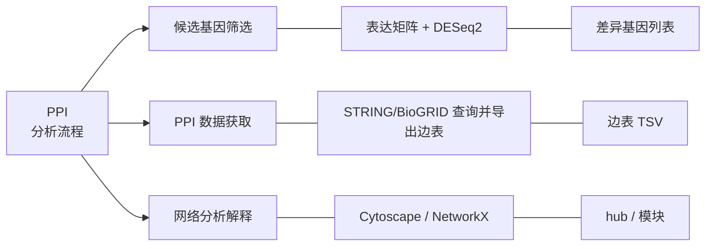

# 生物信息学数据库： 入门教程
## 理解现代医学中的数字基建

---
layout: table-of-contents
contentItems:
  - 蛋白质相互作用网络基础
  - PPI 数据库与数据准备
  - 网络构建与可视化
  - 网络拓扑分析与实操
---

---
layout: table-of-contents
active: 4
contentItems:
  - 蛋白质相互作用网络基础
  - PPI 数据库与数据准备
  - 网络构建与可视化
  - 网络拓扑分析与实操
  - 长标题和紧凑排版验证
---

---
layout: default
density: compact
---

# 长标题换行与紧凑页脚示例：从数据库证据整合到蛋白质相互作用网络解释

这页用于验证标题自动换行、正文深色可读性和普通页脚的紧凑显示。主题仍保留河北医科大学紫色识别，但正文内容不再全部使用紫色。

- 长标题应该自然换行，不截断核心信息
- 普通内容页默认只显示部门和页码
- 紧凑密度适合表格、代码和步骤说明

---
layout: section
sectionNumber: 1
sectionTitle: 蛋白质相互作用网络基础
sectionTitleEn: PPI Network Basics
---

---
layout: default
---

# 为什么研究 PPI 网络

- 蛋白质通常通过相互作用共同完成细胞功能
- PPI 网络把蛋白质表示为节点，把相互作用表示为边
- 网络视角有助于发现 hub 蛋白、功能模块和潜在药物靶点

Pull quote（投影强调句，Markdown `>`；文献用 `hebmu-cite`，不用 callout）：

> 无标度网络 (Scale-free Network) 是许多生物分子网络的典型特征。

---
layout: default
hideTitle: true
---

<div class="h-full flex flex-col items-center justify-center text-center">

# 核心观点

**从“单个基因/蛋白”转向“相互作用网络”，可以更接近细胞系统层面的功能解释。**

</div>

---
layout: default
hideFrame: false
---

# PPI 网络中的两类关系

分栏对比：先左栏，再右栏（`<v-clicks>` 包住两列）。演示 `hideFrame: false` 恢复紫色舞台框（默认关闭）。

<div class="grid grid-cols-2 gap-7 mt-4">

<v-clicks>

<div>

**物理相互作用**

- 蛋白质复合物
- 直接结合证据
- 适合解释分子机制

</div>

<div>

**功能关联**

- 共表达或共同通路
- 文献和数据库证据
- 适合发现功能模块

</div>

</v-clicks>

</div>

---
layout: default
---

# 定义摘录与文献引用

> **无标度网络 (Scale-free Network)**：网络中节点的度分布服从幂律分布 P(k) ~ k^(-γ)，少数枢纽节点 (hub) 拥有大量连接。

<div class="hebmu-cite">Barabási & Albert, Science, 1999</div>

---
layout: default
---

# 案例导入（vignette）

> 一位研究生从 GEO 下载了乳腺癌表达矩阵，用 DESeq2 得到约 120 个差异基因后，不知道如何接到 PPI 网络分析。后面的 STRING → Cytoscape / NetworkX 流程，就是为解决这个问题。

<div class="hebmu-source">课堂案例（示意，非真实队列）</div>

---
layout: section
sectionNumber: 2
sectionTitle: PPI 数据库与数据准备
sectionTitleEn: Data Sources and Preparation
---

---
layout: default
density: compact
---

# 常用 PPI 与通路数据库

| 数据库 Database | 类型 Type | 物种 Species | URL |
|---|---|---|---|
| STRING | PPI | 多物种 | https://string-db.org |
| BioGRID | PPI | 多物种 | https://thebiogrid.org |
| KEGG | 代谢通路 | 多物种 | https://kegg.jp |
| Reactome | 信号通路 | 多物种 | https://reactome.org |

---
layout: figure
title: STRING 数据库
slideTitle: STRING 数据库
figureUrl: /hebmu-logo.png
figureCaption: '数据库界面或检索结果截图可放在此处'
figureX: r
---
# 数据库特点

- 已知和预测的 PPI
- 多种证据来源
  - 实验验证
  - 数据库注释
  - 文本挖掘
- 输出可供 Cytoscape 或 NetworkX 使用的边表

---
layout: default
density: compact
---

# 从表达矩阵筛选候选基因

差异表达分析通常在网络构建之前完成，用于缩小后续 PPI 查询范围。

```r
library(DESeq2)

dds <- DESeqDataSetFromMatrix(
  countData = count_data,
  colData = sample_info,
  design = ~ condition
)
dds <- DESeq(dds)
res <- results(dds, alpha = 0.05)

res_df <- as.data.frame(res)
candidate_genes <- subset(
  res_df,
  !is.na(padj) & padj < 0.05 & abs(log2FoldChange) >= 1
)
```

---
layout: break
breakMinutes: 10
---

---
layout: section
sectionNumber: 3
sectionTitle: 网络构建与可视化
sectionTitleEn: Network Construction and Visualization
---

---
layout: default
---

# PPI 分析流程



---
layout: figure
figureUrl: /campus-end.jpeg
figureCaption: '全页图片布局示例：可替换为 Cytoscape 网络图'
---
# Cytoscape 实操步骤
---
layout: default
---

# Cytoscape 实操步骤

逐步揭示（内置 `<v-clicks>`；空格 / → 下一项）：

<v-clicks>

1. 从 STRING 或 BioGRID 导出 interaction table
2. 在 Cytoscape 中导入网络和节点属性表
3. 使用 degree、betweenness 等指标映射节点大小和颜色
4. 导出网络图，用于报告或后续解释

</v-clicks>

---
layout: section
sectionNumber: 4
sectionTitle: 网络拓扑分析方法
sectionTitleEn: Network Topology Analysis
---

---
layout: default
density: compact
---

# 使用 NetworkX 计算拓扑指标

点击逐步高亮（其余行变暗）：读边表 → 算指标 → 排序 hub/bridge → 打印 → 全显。

```python {1,3|5-7|9-10|12-16|all}{lines:true}
import networkx as nx

G = nx.read_edgelist("ppi_edges.tsv", delimiter="\t")

degree = dict(G.degree())
betweenness = nx.betweenness_centrality(G)
avg_clustering = nx.average_clustering(G)

hub_genes = sorted(degree, key=degree.get, reverse=True)[:10]
bridge_genes = sorted(betweenness, key=betweenness.get, reverse=True)[:10]

print(f"节点数: {G.number_of_nodes()}")
print(f"边数: {G.number_of_edges()}")
print(f"平均聚类系数: {avg_clustering:.2f}")
print("Top hub genes:", hub_genes)
print("Top bridge genes:", bridge_genes)
```

---
layout: default
---

# 中性卡片、标注与来源行

<div class="hebmu-columns">

<div class="hebmu-card">

**物理相互作用**

- 蛋白质复合物
- 直接结合证据

</div>

<div class="hebmu-card">

**功能关联**

- 共表达或共同通路
- 文献和数据库证据

</div>

</div>

<div class="hebmu-callout hebmu-callout-warning">

**注意**：STRING 的边不都是物理相互作用。

</div>

<div class="hebmu-callout hebmu-callout-key">

**关键**：无标度网络里，少数枢纽节点拥有大量连接。

</div>

<div class="hebmu-callout hebmu-callout-check">

**思考**：一个度很高、聚类系数很低的节点说明什么？

</div>

<div class="hebmu-callout hebmu-callout-procedure">

STRING 查询 → 导出 TSV → Cytoscape 导入 → 按 Degree 着色

</div>

<div class="hebmu-source">数据为示例，不对应某一版数据库。</div>

---
layout: default
---

# 标注变体：成功与危险

<div class="hebmu-callout hebmu-callout-success">

**成功**：边表导出成功，共 1,024 条相互作用，已写入 ppi_edges.tsv。

</div>

<div class="hebmu-callout hebmu-callout-danger">

**危险**：padj 未校正，p 值直接使用会带来大量假阳性。

</div>

<div class="hebmu-source">绿色 success 与红色 danger 为 0.4.0 新增变体。</div>

---
layout: section
sectionNumber: 5
sectionTitle: 动画演示
sectionTitleEn: Animation Preview
transition: slide-up
---

---
layout: default
transition: fade
---

# 列表逐步出现（v-clicks）

本页换页过渡为 `fade`（全书默认仍是 headmatter 里的 `slide-left`）。

<v-clicks>

- **Hub**：高度数节点，常是功能关键蛋白
- **Bridge**：高介数中心性，连接不同模块
- **模块**：内部连接密、对外连接疏的子网

</v-clicks>

---
layout: default
---

# 点击揭示 + 划线标注（v-click / v-mark）

<div v-click>

<div class="hebmu-callout hebmu-callout-key">

**关键**：先看度分布，再解释 hub。

</div>

</div>

<p v-click>
<span v-mark.underline.orange>无标度网络</span> 中，少数节点拥有大量连接。
</p>

<p v-click>
<span v-mark.circle>聚类系数低且度数高</span> → 可能是桥接节点。
</p>

<div class="hebmu-source">另见 NetworkX 页的代码行高亮 `{1|2|…|all}`（点击逐步变暗其余行）。</div>

---
layout: default
---

# 先错后对（v-click.hide + v-after）

开场即见误区；再点一次：误区淡出，正确说法同时出现。

<div v-click.hide>

<div class="hebmu-callout hebmu-callout-danger">

**误区**：STRING 上的边都是直接物理结合。

</div>

</div>

<div v-after>

<div class="hebmu-callout hebmu-callout-success">

**正确**：STRING 边含实验、文本挖掘与预测；课上要读证据通道。

</div>

</div>

---
layout: default
---

# 同屏对比（同一点击）

一次点击同时亮出「注意」与「关键」，适合对照讲解。

<div class="grid grid-cols-2 gap-7 mt-4">

<div v-click="1">

<div class="hebmu-callout hebmu-callout-warning">

**注意**：padj 未校正会带来假阳性。

</div>

</div>

<div v-click="1">

<div class="hebmu-callout hebmu-callout-key">

**关键**：报告差异基因时写明阈值与 |log2FC|。

</div>

</div>

</div>

<div v-click>

<div class="hebmu-callout hebmu-callout-procedure">

导出边表 → Cytoscape 着色 → 记录 hub 名单

</div>

</div>

---
layout: default
density: compact
---

# 代码演变（magic-move）

点击逐步变形：从读边表到算度中心性（Shiki Magic Move）。

````md magic-move {lines: true}
```python
import networkx as nx

G = nx.read_edgelist("ppi_edges.tsv", delimiter="\t")
print(G.number_of_nodes(), G.number_of_edges())
```

```python
import networkx as nx

G = nx.read_edgelist("ppi_edges.tsv", delimiter="\t")
degree = dict(G.degree())
hubs = sorted(degree, key=degree.get, reverse=True)[:10]
print("Top hubs:", hubs)
```

```python
import networkx as nx

G = nx.read_edgelist("ppi_edges.tsv", delimiter="\t")
degree = dict(G.degree())
betweenness = nx.betweenness_centrality(G)
hubs = sorted(degree, key=degree.get, reverse=True)[:10]
bridges = sorted(betweenness, key=betweenness.get, reverse=True)[:10]
print("hubs:", hubs)
print("bridges:", bridges)
```
````

---
layout: default
---

# Rough 划掉 / 高亮 / 框选（v-mark）

黑板批注感：划掉误区、高亮术语、框住结论（Rough Notation）。

<p>
<span v-mark.strike-through.red>STRING 边都是物理结合</span>
　← 点击后划掉
</p>

<p v-click>
再强调：<span v-mark.highlight.orange>证据通道</span> 与
<span v-mark.box="{ color: '#621887' }">hub 解释</span> 要一起写进报告。
</p>

<div class="hebmu-source">类型：`strike-through` / `highlight` / `box`（另有 underline、circle）。</div>

---
layout: default
---

# 手绘批注（drawings）

内置画笔：授课时按 <kbd>C</kbd> 打开绘图，在图上圈 hub / 连线。

本页可练习——用笔标出「先筛基因 → 再取边表」的顺序。


<div class="hebmu-source">headmatter 已设 `drawings.persist: false`（演示不落盘）；导出需持久化时可改 `true`。</div>

---
layout: default
---

# 弹簧弹跳（v-motion spring）

`transition.type: 'spring'` — 比线性 easing 更有弹性；降低 `damping` 会更“弹”。

<div
  v-motion
  :initial="{ y: 80, opacity: 0, scale: 0.85 }"
  :enter="{
    y: 0,
    opacity: 1,
    scale: 1,
    transition: {
      type: 'spring',
      stiffness: 280,
      damping: 18,
      mass: 0.6,
    },
  }"
  :click-1="{
    scale: 1.08,
    transition: { type: 'spring', stiffness: 400, damping: 12 },
  }"
  class="hebmu-callout hebmu-callout-key mt-4"
>
  **Hub 蛋白**：进场自下弹入；再点一次弹簧放大。
</div>

<div
  v-click
  v-motion
  :initial="{ y: 56, opacity: 0, scale: 0.9 }"
  :enter="{
    y: 0,
    opacity: 1,
    scale: 1,
    transition: { type: 'spring', stiffness: 320, damping: 16, mass: 0.55 },
  }"
  class="hebmu-callout hebmu-callout-procedure mt-4"
>
  配合 `v-click`：点击后弹簧浮现 — STRING → Cytoscape → 记录 hub。
</div>

<div class="hebmu-source">`stiffness`↑ 更脆；`damping`↓ 更晃。非 Magic Move，不做代码字形变形。</div>

---
layout: default
---

# 列内堆叠标注（fixture: #72）

<div class="hebmu-columns">

<div>

**Z-score 标准化**

```python
z = (expr - expr.mean()) / expr.std()
print(z.shape, z.iloc[:3, :3])
```

<div class="hebmu-callout hebmu-callout-check">

实测范围 **−1.13 ~ 4.73** —— 下一讲热图以这个矩阵为输入

</div>

<div class="hebmu-callout hebmu-callout-key">

**按列广播**：`expr.mean()` 是 Series，减法自动按列对齐铺开

</div>

<div class="hebmu-callout hebmu-callout-warning">

⚠️ `mean/std` 默认 `axis=0`（按列），`0=行、1=列`

</div>

</div>

<div>

**R 对照**

```r
scale(x, center = TRUE, scale = TRUE)
```

<div class="hebmu-card">

**同构**：`scale()` = 中心化 + 除以标准差

</div>

<div class="hebmu-card">

**口径**：R 的 `sd` 与 pandas `.std()` 同用 ddof=1

</div>

<div class="hebmu-callout hebmu-callout-procedure">

`apply(z, 2, scale)` → 热图聚类前常做这一步

</div>

</div>

</div>

<div class="hebmu-source">fixture：右列 `pre` + 卡片/标注混排，验证列内相邻间距与列首贴齐（normal 密度）。</div>

---
layout: default
density: compact
---

# 列内堆叠标注 · 紧凑（fixture: #72）

<div class="hebmu-columns">

<div>

**Z-score 标准化**

```python
z = (expr - expr.mean()) / expr.std()
print(z.iloc[:3, :3].round(2))
```

<div class="hebmu-callout hebmu-callout-check">

实测范围 **−1.13 ~ 4.73** —— 下一讲热图以这个矩阵为输入

</div>

<div class="hebmu-callout hebmu-callout-key">

**按列广播**：Series 减法自动按列对齐铺开

</div>

<div class="hebmu-callout hebmu-callout-warning">

⚠️ `mean/std` 默认 `axis=0`（按列），`0=行、1=列`

</div>

</div>

<div>

**R 对照**

```r
scale(x, center = TRUE, scale = TRUE)
```

<div class="hebmu-card">

**同构**：`scale()` = 中心化 + 除以标准差

</div>

<div class="hebmu-callout hebmu-callout-procedure">

`apply(z, 2, scale)` → 热图聚类前常做这一步

</div>

</div>

</div>

<div class="hebmu-source">fixture：紧凑密度下的同一布局（compact 间距 10px）。</div>

---
layout: end
endMessage: '谢谢！'
endMessageEn: 'Thank You!'
---
